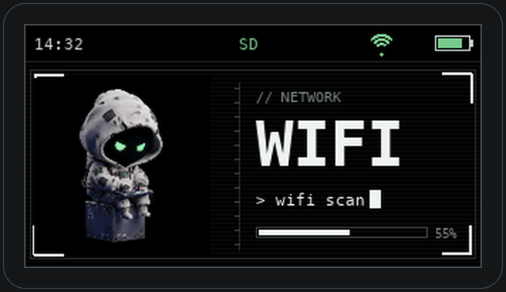
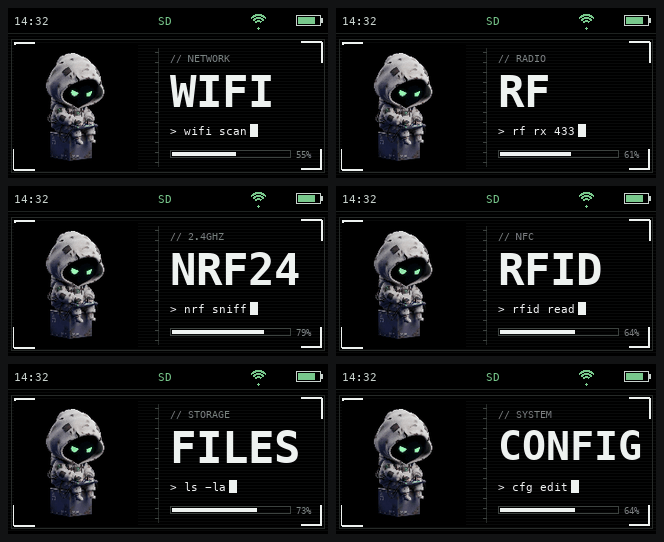
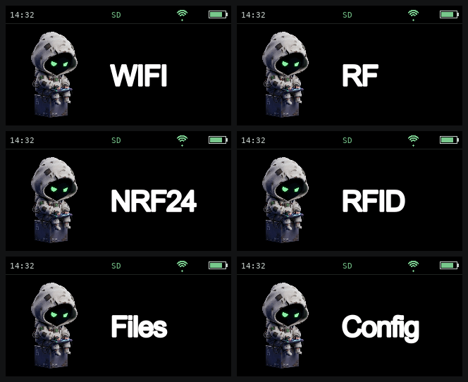

# 🕶️ Bruce Hacker Theme

🇺🇸 <b>English</b> · 🇫🇷 <a href="README.fr.md">Français</a>

  

A UI theme for the **[Bruce](https://github.com/BruceDevices/firmware)** firmware, designed for the
**LilyGO T-Embed CC1101** (320×170 screen). A small hooded hacker with green
eyes shows up on **every menu entry**, with the menu name to its right.

Two variants are included:

| Variant | Style | Preview |
|----------|-------|--------|
| **Hacker v2** | Character on the left, plain label on the right | [view](docs/hacker-v2.png) |
| **Hacker v3** | "Technical HUD" interface: frame, category, terminal line, progress bar | [view](docs/hacker-v3.png) |

### Hacker v3 — technical HUD

### Hacker v2 — clean

## 📦 Contents

- `Hacker v2/` — 16 GIFs (320×140) + `Hacker v2.json`
- `Hacker v3/` — 16 GIFs (320×140) + `Hacker v3.json`

Each theme covers the **16 entries** of the Bruce menu: WiFi, BLE, RF, RFID, FM, IR,
Files, GPS, NRF24, Interpreter, Others, Clock, Connect, Config, Ethernet, LoRa.

## 🚀 Installation

### From the SD card
1. Copy the `Hacker v3` (or `Hacker v2`) folder to the root of the SD card.
2. On the device: **Config → UI Theme → SD Card → `Hacker v3/Hacker v3.json`**.

### From the WebUI (WiFi, no card to remove)
1. On the device: **Files → WebUI**.
2. Join the WiFi network shown, open the IP address in your browser.
3. Upload the theme folder to the SD card or LittleFS, then select the `.json`
   in **Config → UI Theme**.

## 🎨 Technical notes

- The menu name is **baked into the image** and `label` is set to `0`: that is what
  puts the text **to the right** of the character (the firmware itself always draws
  the label centered *below* the icon).
- The top of the screen (time, SD, WiFi, battery) is **left empty**: those are the
  status icons drawn by the firmware, nothing goes there.
- Static GIFs (1 frame), ~7–9 KB each → light for the ESP32.
- Colors (`priColor` / `secColor` / `bgColor`) in RGB565 format in the `.json`.

## 🖥️ Compatibility

Designed for the **LilyGO T-Embed CC1101** (320×170). Should work on other
Bruce targets with a similar resolution; on smaller/larger screens,
the images may be cropped.

## 🛒 Hardware

*Amazon affiliate links: if you buy through these links, the project earns a small commission at no extra cost to you.*

<table>
<tr>
<td align="center" width="33%">
   
  <b><a href="https://www.amazon.com/dp/B0D45MSMJR?linkCode=ll2&amp;tag=koua29bhackertheme-20&amp;ref_=as_li_ss_tl">Anker 545 power bank (10,000 mAh)</a></b> Keeps the T-Embed running away from an outlet
</td>
<td align="center" width="33%">
   
  <b><a href="https://www.amazon.com/dp/B0C1FCZM94?linkCode=ll2&amp;tag=koua29bhackertheme-20&amp;ref_=as_li_ss_tl">433 MHz SMA antenna (2-pack)</a></b> Sub-GHz antenna for the CC1101 radio
</td>
<td align="center" width="33%">
   
  <b><a href="https://www.amazon.com/dp/B0B7NVMBPL?linkCode=ll2&amp;tag=koua29bhackertheme-20&amp;ref_=as_li_ss_tl">SanDisk 64 GB microSD (2-pack)</a></b> For Bruce themes, scripts and captures
</td>
</tr>
</table>

As an Amazon Associate I earn from qualifying purchases.

## ☕ Buy me a coffee

If you like this theme, you can buy me a coffee:

## 📄 License

MIT — see [LICENSE](LICENSE). Theme by **koua29**.
